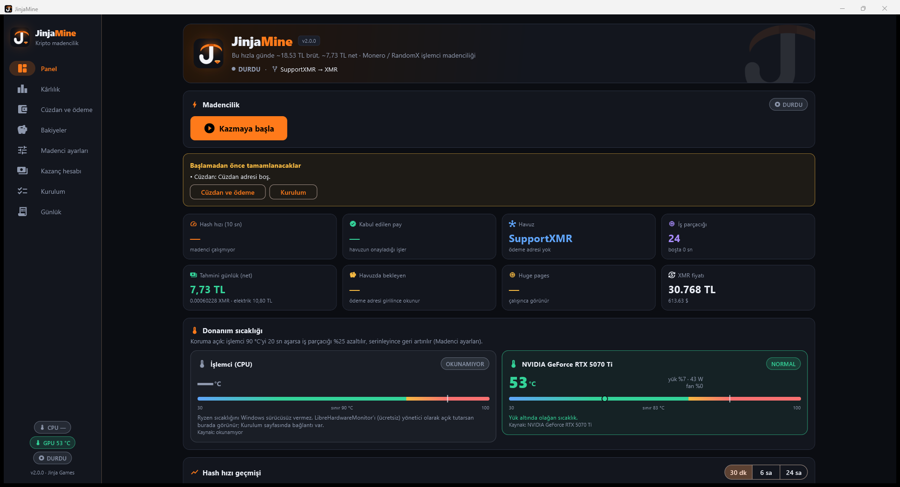
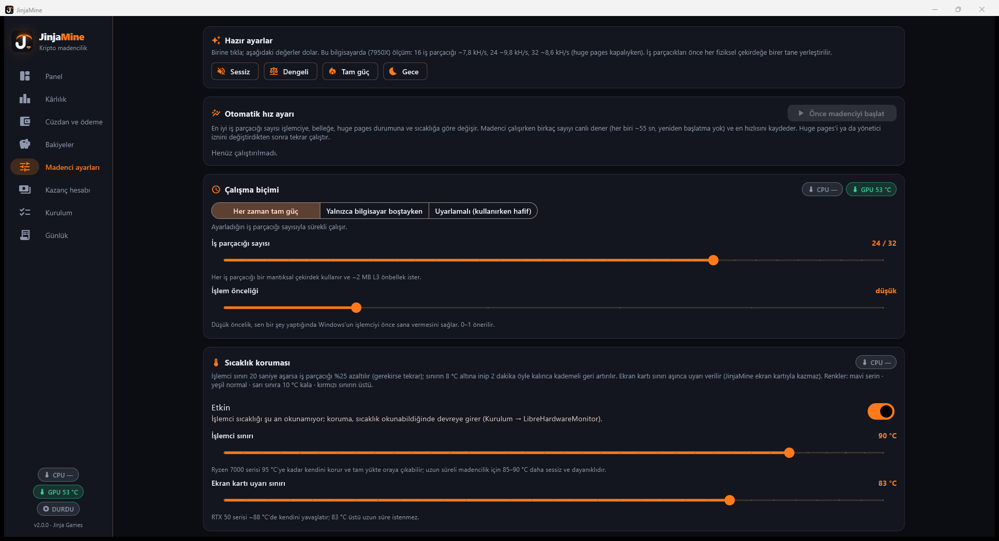

<div align="center">


# JinjaMine

**XMRig için Türkçe Windows ön yüzü: Monero (RandomX) işlemci madenciliğini kurar, ayarlar, izler ve kazancı dürüstçe hesaplar.**


</div>

JinjaMine, resmî [XMRig](https://github.com/xmrig/xmrig) madencisini senin yerine yapılandırıp çalıştırır. Havuz, ödeme yolu, iş parçacığı sayısı ve sıcaklık sınırı gibi ayarları tek pencerede toplar. Kazancı da canlı ağ verisi ve elektrik maliyetiyle birlikte gerçekçi biçimde gösterir.

<p align="center"></p>

> **Gerçekçi beklenti.** Ev bilgisayarıyla işlemci madenciliği küçük para getirir. Geliştirildiği Ryzen 9 7950X'te ölçülen hız ~9,8 kH/s, bu da günde birkaç on TL brüt demek; elektriği düşünce net kazanç daha da azalır. Ayrıntılar [docs/01_GERCEKCI_BEKLENTI.md](docs/01_GERCEKCI_BEKLENTI.md) içinde. JinjaMine kazancı abartmaz, aksine sana tam olarak ne kadar kazandığını gösterir.

## Öne çıkanlar

- **Kârlılık sıralaması.** WhatToMine, xmrchain ve CoinGecko'dan canlı veriyle RandomX havuzlarını ve ödeme yollarını karşılaştırır. Ücret ve gecikmeyi hesaba katar; istersen en kârlıya kendiliğinden geçer.
- **Dört ödeme yolu.** Kendi Monero cüzdanın, unMineable üzerinden TRX/LTC/USDT (Binance'e yatırılabilir), NiceHash veya uygulamanın oluşturduğu yerel cüzdan.
- **Cüzdansız başlangıç.** Uygulama Windows DPAPI ile şifrelenmiş yerel bir Monero cüzdanı üretebilir. Adres ve anahtarlar bilgisayarından hiç çıkmaz.
- **Akıllı iş parçacığı ayarı.** İş parçacıklarını önce her fiziksel çekirdeğe birer tane yerleştirir (ölçülen fark: %40'a kadar). Otomatik hız ayarı madenciyi yeniden başlatmadan farklı sayıları canlı dener.
- **Çalışma biçimleri.** Her zaman tam güç, yalnızca bilgisayar boştayken veya kullanırken hafif.
- **Sıcaklık koruması.** İşlemci sınırı aşarsa iş parçacığını azaltır, soğuyunca geri açar. Ekran kartı sıcaklığını da izler (nvidia-smi, LibreHardwareMonitor).
- **Bakiyeler ve kazanç hesabı.** Havuzdaki bekleyen bakiyeyi okur. Günlük, aylık brüt ve net kazancı elektrik fiyatıyla birlikte hesaplar.
- **Türkçe rehber.** Kurulumdan güvenlik ve vergi konularına kadar 18 sayfalık rehber: [JinjaMine_Rehber.pdf](JinjaMine_Rehber.pdf).

<p align="center"></p>

## Kurulum

1. [Releases](../../releases) sayfasından `JinjaMine-x.y.z-windows.zip` dosyasını indirip bir klasöre çıkar.
2. XMRig'i **resmî** sayfadan indir: [github.com/xmrig/xmrig/releases](https://github.com/xmrig/xmrig/releases/latest) (`xmrig-x.y.z-windows-x64.zip`). Zip içindeki `SHA256SUMS` ile karşılaştırarak doğrula.
3. XMRig zip'ini `JinjaMine.exe`'nin yanındaki `xmrig` klasörüne çıkar:
   ```
   JinjaMine\
   ├─ JinjaMine.exe
   └─ xmrig\
      └─ xmrig-6.26.0\xmrig.exe
   ```
4. `JinjaMine.exe`'yi aç. XMRig kendiliğinden bulunur. **Cüzdan ve ödeme** sayfasından bir ödeme yolu seç ve **Kazmaya başla**'ya bas.

Gereksinim: Windows 10 veya 11 (64 bit). Bir kez yönetici olarak çalıştırıp Windows oturumunu kapatıp açarsan huge pages ve MSR açılır; hız belirgin artar.

### Antivirüs uyarısı

Windows Defender ve diğer antivirüsler XMRig'i "HashvaultMiner" ya da "CoinMiner" diye işaretler. Bunun nedeni XMRig'in kötü amaçlı yazılımlarda gizlice kullanılmasıdır, resmî sürümün kendisinde sorun yoktur. XMRig'i yalnızca resmî GitHub sayfasından indir, SHA-256'yı doğrula ve gerekirse yalnızca `xmrig` klasörü için dışlama ekle. JinjaMine bu dosyayı paketlemez; her zaman kendin indirirsin.

## Sayfalar

| Sayfa | Ne yapar |
|---|---|
| Panel | Başlat / durdur, anlık hız, kabul edilen pay, tahmini günlük kazanç, sıcaklık, hız geçmişi |
| Kârlılık | Havuz ve ödeme yolu sıralaması, öneri, otomatik geçiş |
| Cüzdan ve ödeme | Monero adresi, unMineable (TRX/LTC/USDT), NiceHash, yerel cüzdan |
| Bakiyeler | Havuzlardaki bekleyen ve ödenen bakiyeler |
| Madenci ayarları | Hazır ayarlar, iş parçacığı, öncelik, çalışma biçimi, sıcaklık koruması, Windows ile başlat |
| Kazanç hesabı | Güç tüketimi ve elektrik fiyatıyla net kazanç |
| Kurulum | XMRig konumu, huge pages, antivirüs, sıcaklık okuma |
| Günlük | XMRig çıktısı |

## Nasıl çalışır?

```
JinjaMine ──► config.json yazar ──► xmrig.exe ──► havuz (TLS) ──► ödeme adresin
    ▲                                   │
    └──── 127.0.0.1 HTTP API (token) ◄──┘   hız, paylar, canlı ayar değişikliği
```

JinjaMine XMRig'i alt süreç olarak başlatır ve onunla yalnızca yerel, rastgele anahtarla korunan HTTP API üzerinden konuşur. İş parçacığı sayısı gibi değişiklikleri madenciyi yeniden başlatmadan uygular. Ayarlar `%APPDATA%\com.jinjagames\JinjaMine`, XMRig yapılandırması ve yerel cüzdan `%APPDATA%\JinjaMine` altında tutulur.

**Gizlilik:** Uygulamanın kendine ait bir sunucusu yok ve telemetri göndermez. Dışarıya yalnızca seçtiğin havuza ve fiyat/ağ verisi için herkese açık API'lere (WhatToMine, xmrchain, CoinGecko, havuz API'leri) bağlanır. Senden hiçbir zaman seed ya da şifre istemez.

**Bağış:** XMRig'in geliştirici bağışı resmî sürümdeki en düşük değer olan %1'de bırakılır. Bu pay XMRig geliştiricilerine gider, JinjaMine'a değil.

## Belgeler

| Belge | Konu |
|---|---|
| [01 Gerçekçi beklenti](docs/01_GERCEKCI_BEKLENTI.md) | Formül, ölçülen hız, günlük/aylık kazanç |
| [02 Cüzdan](docs/02_CUZDAN.md) | Monero cüzdanı, Binance yolu, "cüzdan sonra" |
| [03 Kurulum](docs/03_KURULUM.md) | Adım adım kurulum, huge pages |
| [04 Havuzlar](docs/04_HAVUZLAR.md) | Havuz karşılaştırması |
| [05 Güvenlik ve yasal](docs/05_GUVENLIK_VE_YASAL.md) | Antivirüs, vergi, yasal durum |
| [06 SSS ve sorun giderme](docs/06_SSS_SORUN_GIDERME.md) | Sık karşılaşılan sorunlar |
| [07 Kârlılık, sıcaklık, bakiye](docs/07_KARLILIK_SICAKLIK_BAKIYE.md) | Sıralama mantığı, sıcaklık koruması |
| [SISTEM.md](SISTEM.md) | Referans bilgisayar ve ölçümler |

## Kaynaktan derleme

Flutter (stable, Windows masaüstü desteğiyle) ve Visual Studio C++ araçları gerekir.

```bash
cd app
flutter pub get
flutter build windows --release --no-tree-shake-icons
```

Çıktı `app\build\windows\x64\runner\Release\` altındadır; `dist\JinjaMine\` klasörüne kopyalanınca uygulama proje kökündeki `xmrig\` klasörünü de bulur.

Testler sahte bir XMRig kullanır:

```bash
cd app
dart compile exe tool/fake_xmrig.dart -o build/fake_xmrig.exe
flutter test
```

İkon `app/tool/make_icon.py` (Pillow) ile üretilir. Rehber `docs/build_rehber.py` ile yeniden oluşturulur.

## Sorumluluk reddi

JinjaMine yalnızca sana ait bilgisayarda, kendi isteğinle madencilik içindir. Başkasının bilgisayarında, iş yerinde veya okulda izinsiz çalıştırma. Kripto para fiyatları oynaktır; uygulamadaki kazanç tahminleri yatırım tavsiyesi değildir. Elektrik, donanım yıpranması ve vergi sorumluluğu kullanıcıya aittir.

## Lisans

[MIT](LICENSE) © Jinja Games. XMRig ayrı bir projedir ve kendi GPL-3.0 lisansıyla dağıtılır.
